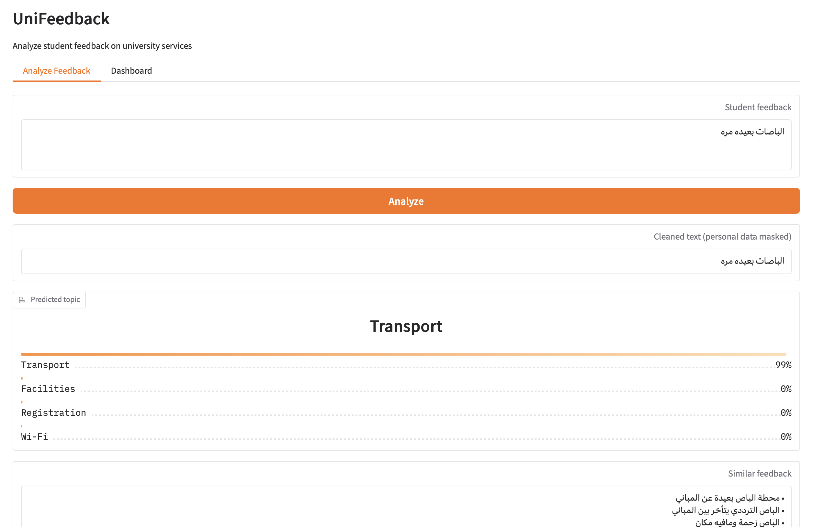
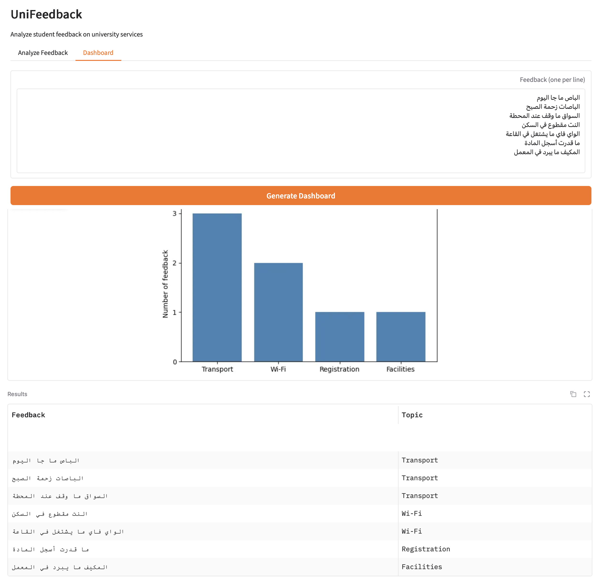

# UniFeedback
### An NLP System for Analyzing Student Feedback on University Services

## Overview

University members — students, staff, and faculty — face many issues with university services, such as registration system failures, late buses, weak Wi-Fi, and broken facilities. Many universities lack an easy, fast channel for reporting these issues, or a clear unit that collects and analyzes them. Feedback also arrives in large volumes, in Arabic and English, and in both Modern Standard Arabic and dialect, which makes manual review slow and causes important issues to be missed.

UniFeedback addresses this by analyzing feedback automatically using Transformer models. It cleans the text and masks personal data, classifies each comment by topic, and searches for similar feedback even across languages — helping the university identify its most frequent problems and prioritize improvements.

## Project Contents

| Stage | Description | Source |
|---|---|---|
| 1 | Text cleaning and personal data masking (phone numbers and emails) | Lab 1 |
| 2 | Understanding words in context through attention, and PAD leak testing | Lab 2 |
| 3 | Classifying feedback by topic: registration, transport, Wi-Fi, facilities | Lab 3A |
| 4 | Handling Arabic features: clitics, letter normalization, dialects | Lab 3B, Lab 4 |
| 5 | Bilingual semantic search for similar feedback (Arabic and English) | Lab 5 |
| 6 | Sliced evaluation and error analysis | Lab 6 |
| 7 | Demo: classifying new feedback, a topic chart, and similar-feedback search | Demo |
| 8 | Interactive web demo with a feedback input box and a dashboard (Gradio) | Demo |

## Demo

The demo is at the end of `UniFeedback.ipynb`:

- **Section 7:** classifies new feedback the model has never seen, plots a chart of feedback per topic, and runs an English query that retrieves similar Arabic feedback.
- **Section 8 — Interactive Web Demo (Gradio):** a web interface where the user types feedback and gets the masked text, the predicted topic with a confidence score for each topic, and the most similar feedback. A Dashboard tab classifies multiple comments at once and draws a chart of feedback per topic.

**Analyze Feedback**

**Dashboard**

---

**Author:** Hind Talal Alotaibi
